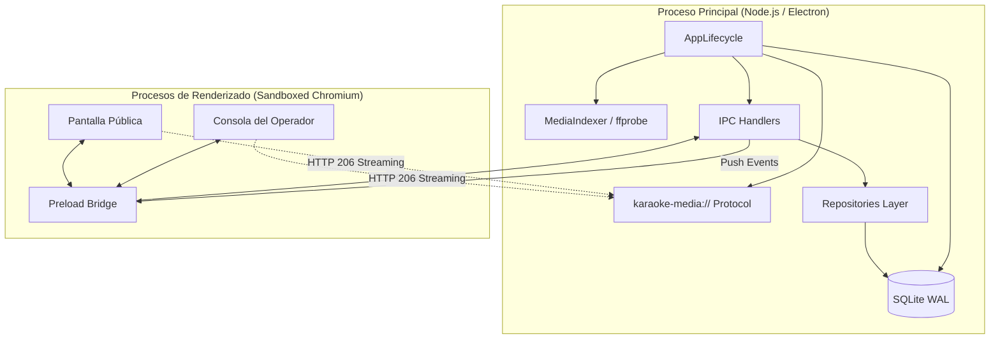
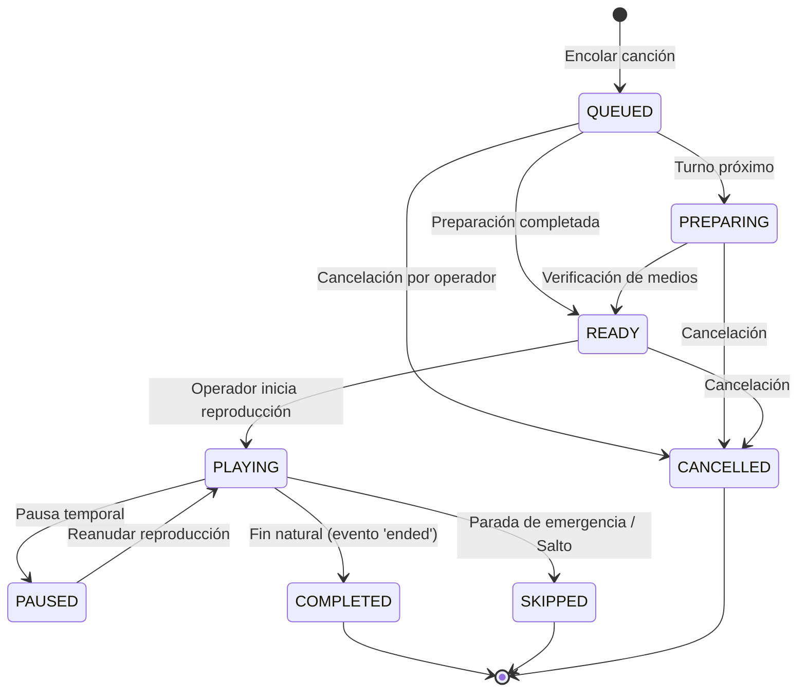

# Arquitectura del Sistema — Karaoke Total (MVP Local)

Documento técnico descriptivo de los componentes, modelos de datos, máquinas de estado y patrones de diseño utilizados en **Karaoke Total**.

---

## 1. Visión General del Monorepo

El proyecto está estructurado como un monorepo administrado con `pnpm` workspaces:

```text
karaoke-total/
├── apps/
│   └── desktop/               # Aplicación Electron (Main, Preload y Renderer)
│       ├── src/main/          # Proceso principal: ventanas, ciclo de vida, IPC, protocolo multimedia
│       ├── src/preload/       # Puentes tipados y aislados con contextBridge
│       └── src/renderer/      # Interfaz de usuario (React 18 + Vite + Tailwind/CSS)
└── packages/
    ├── contracts/             # Esquemas Zod, DTOs, constantes de canales IPC y tipos TypeScript
    ├── database/              # SQLite + Drizzle ORM, migraciones atómicas y repositorios
    ├── media-indexer/         # Escaneo no bloqueante, ffprobe, watcher (Chokidar) y normalización
    └── media-engine/          # Parser RFC 7233 de rangos HTTP 206 y contrato de eventos de reproducción
```

---

## 2. Diagrama de Procesos y Comunicación



---

## 3. Modelo de Persistencia Local (SQLite + Drizzle ORM)

La base de datos se localiza en `%APPDATA%\karaoke-total\karaoke_total.sqlite`, operando en modo **WAL (Write-Ahead Logging)** para permitir lecturas concurrentes sin bloquear escrituras:

- **`settings`**: Configuración de idioma, tema, volumen maestro/karaoke/ambiente y asignación de identificadores de pantallas.
- **`media_folders`**: Directorios autorizados por el usuario en disco con control de estado de escaneo.
- **`media_assets`**: Archivos físicos individuales analizados con tamaño, fecha de modificación, huella rápida, códecs de audio/vídeo y estado (`READY`, `INCOMPATIBLE`, `MISSING`, `CORRUPT`).
- **`songs`**: Metadatos musicales (Título, Artista, Género, Búsqueda normalizada insensible a tildes y fuente de metadatos `FILENAME` o `MANUAL`).
- **`karaoke_sessions`**: Sesiones de directo con marca temporal de apertura y cierre.
- **`singers`**: Cantantes registrados con alias y mesa/ubicación.
- **`queue_items`**: Turnos en cola asociados a sesión, cantante, canción, tono solicitado (±6 semitonos), estado de cola y posición ordinal.
- **`queue_events`**: Registro inmutable de auditoría para cada cambio de estado, salto, reordenación o pausa en la cola.
- **`playback_state`**: Singleton persistente que almacena en tiempo real la canción activa, posición de reproducción, volumen y estado del motor.

---

## 4. Máquina de Estados de la Cola

Cada turno en cola sigue una máquina de estados determinista gobernada por `isValidQueueTransition`:



### Reglas Inviolables de la Máquina de Estados:
1. **Regla de Reproducción Única:** No pueden coexistir dos elementos en estado `PLAYING` simultáneamente en la misma sesión.
2. **Finalización Estricta:** La transición a `COMPLETED` se desencadena **únicamente** por el evento nativo del DOM `ended` emitido por el elemento HTML5 `<video>` en la pantalla pública.
3. **Reconciliación al Inicio:** Si la aplicación se reinicia mientras una canción estaba en `PLAYING`, la canción se restablece a `READY` sin reproducirse automáticamente.

---

## 5. Empaquetado y Distribución para Windows

- **Herramienta:** `electron-builder` configurado con destino **NSIS x64**.
- **Binarios Nativos:** `better-sqlite3` utiliza binarios precompilados estables N-API (`win32-x64.node`) evitando la necesidad de instalar herramientas de compilación C++ en la máquina cliente.
- **Binarios Auxiliares:** `ffprobe.exe` se extrae a `resources/app.asar.unpacked/node_modules/ffprobe-static/bin/win32/x64/ffprobe.exe` para permitir su ejecución nativa no bloqueante mediante `child_process.spawn`.
